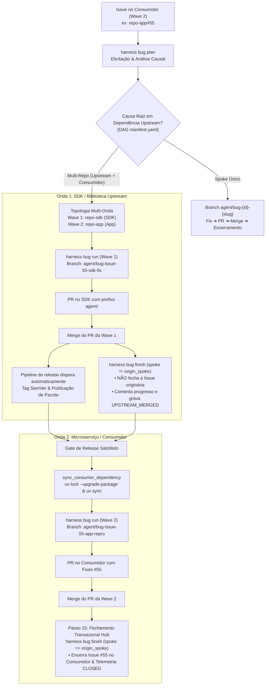

# Plano de Implementação: Ciclo de Resolução de Bugs Guiado por SDD (Spec-Driven Bugfix Lifecycle)

> **Documento Oficial de Arquitetura e Engenharia de Processos.**  
> Este documento formaliza o fluxo de tratamento, reprodução, análise de causa raiz e reconciliação de bugs com o acervo de especificações do ecossistema.  
> Ele ancora-se expressamente nas definições da arquitetura central descrita em [`federated-sdd-platform.md`](./federated-sdd-platform.md), com ênfase na **Simetria Canônica entre o Ciclo Local-First e o Ciclo Cloud (Remoto)**, na **Persistência da Issue como SSOT do Defeito**, no **Gatilho Canônico por Transição de Status da Issue**, na **Triagem Cross-Repo de Incerteza**, na **Leitura Direta e Segura de Logs pelo Servidor de Planejamento / Cloud Runner via WIF com Menor Privilégio Estrito (`roles/logging.viewer`)** e no **Loop Iterativo de Investigação com Janelas de Horário Variáveis e Seleção Curada de Logs**.

---

## 1. Visão Geral e Princípios Operacionais

No ecossistema de **Spec-Driven Development (SDD) Federado**, a abordagem para tratamento de defeitos difere fundamentalmente do fluxo de novas funcionalidades, mas compartilha a mesma disciplina de planejamento:

```
┌────────────────────────────────────────────────────────────────────────────────────────┐
│                        COMPARAÇÃO DE FLUXOS NO ECOSSISTEMA SDD                         │
├────────────────────────────────────────────────────────────────────────────────────────┤
│ Fluxo de Feature (Top-Down):                                                           │
│   Prompt de Intenção ➔ Modo Planejamento de Spec ➔ Spec Mestre no Hub                 │
│   ➔ Fan-Out de Sub-Specs ➔ Implementação TDD ➔ Gate ➔ Merge                           │
├────────────────────────────────────────────────────────────────────────────────────────┤
│ Fluxo de Bug (Bottom-Up com Leitura Direta, Logs Curados e Gatilho de Status):         │
│   Prompt de Relato ➔ Modo Planejamento de Bug (Bug Intake) ➔ Triagem Cross-Repo        │
│   ➔ Leitura Direta de Logs via WIF (API Cloud Logging < 500ms, SA logging.viewer)      │
│   ➔ Seleção Curada da Evidência ➔ Registro da Issue (SSOT)                             │
│   ➔ Gatilho por Transição de Status (ready) ➔ Geração Automatizada do Teste TDD (Red)  │
│   ➔ Análise de Causa Raiz (RCA) ➔ Reconciliação com Specs (Hub) ➔ Fix (Green)         │
│   ➔ Gate de Avaliação (Judge) ➔ Fechamento Transacional da Issue                       │
└────────────────────────────────────────────────────────────────────────────────────────┘
```

### Premissas Basilares do Ciclo de Bug:
1. **Especificação Prévia via Prompt (Bug Intake Planning Mode):** Nenhum bug é registrado como uma Issue crua ou vaga no GitHub sem antes passar por um **modo de planejamento interativo guiado por prompt**, exatamente como ocorre no planejamento de uma nova spec (`harness spec start`). O prompt do desenvolvedor elicita sintomas, comportamento observado vs. esperado, passos de reprodução, componentes afetados e especificação do teste TDD.
2. **Leitura Direta e Segura pelo Servidor de Planejamento / Cloud Runner:** Em vez de despachar pipelines pesados de compilação como o Cloud Build (que introduzem latência de 1 a 3 minutos e dependências excessivas), o **próprio servidor que realiza o planejamento do bug na Cloud (o Runner remoto isolado onde opera o agente autônomo)** autentica-se diretamente via **Workload Identity Federation (WIF)** e consome a API do Google Cloud Logging com latência inferior a 500ms. A Service Account assumida via WIF possui permissão estrita e exclusiva de leitura de logs (`roles/logging.viewer`), garantindo o princípio do menor privilégio sem acesso a dados, sem chaves estáticas e sem privilégios destrutivos.
3. **Loop Iterativo de Investigação de Logs com Horários Variáveis:** Na fase de planejamento, o operador ou agente executa consultas instantâneas e repetidas variando parâmetros de horário (`--since`, `--start-time`, `--end-time`), filtros de container e severidade até localizar a anomalia em tempo real.
4. **Seleção Curada de Evidência na SSOT:** Ao final da investigação iterativa, **somente o trecho cirúrgico de log selecionado** (stack trace, erro 5xx ou falha de negócio) é incorporado ao corpo da Issue. Logs intermediários e ruídos exploratórios são descartados.
5. **Capacidade Genérica de Cloud Logging no Harness:** A observabilidade de nuvem e a extração de logs via `gcloud` CLI são capacidades abstratas e desacopladas no `harness-state`. O motor não possui projetos, clusters ou credenciais hardcoded.
6. **Configuração Declarativa de Nuvem Centralizada no `spec-hub`:** Todas as variáveis e definições de infraestrutura (Project ID, cluster, namespace, Workload Identity Federation e filtros) são declaradas exclusivamente no `manifest.yaml` do `<project>-spec-hub`, sendo consumidas dinamicamente pelo motor do harness e pelos workflows reutilizáveis.
7. **A Issue como Single Source of Truth (SSOT) do Defeito:** O diálogo interativo, os sintomas, os logs de evidência curados e a especificação do teste unitário são **persistidos diretamente no corpo da Issue** no repositório spoke (ou no hub, se incerto).
8. **Tratamento de Incerteza do Repositório (Triagem Cross-Repo):** Quando o usuário ou agente não tem certeza de onde o defeito se origina, a Issue nasce como uma **Issue de Triagem Centralizada no `spec-hub`**, sendo roteada ou decomposta via fan-out após a análise de capabilities e telemetria distribuída.
9. **Gatilho Canônico por Transição de Status da Issue (Issue State Trigger):** Assim como a alteração ou aprovação de status de uma spec no `spec-hub` dispara a propagação de mudanças e a geração de código, **a transição de status da Issue** (ex: `status:bug/ready` ou label `bug:ready`) é o gatilho formal que aciona a esteira, disparando a **geração automatizada do arquivo de teste de reprodução** e a execução hermética do pipeline.
10. **Separação entre Issue e Spec:** O bug gera uma **Issue** no GitHub e no State Tracker (Redis), mas **não gera uma nova spec imediatamente**.
11. **Reprodução Obrigatória (TDD Fail-First):** É inegociável gerar e executar um teste automatizado (`Red`) com docstring `Business Rule:` que comprove a falha antes de qualquer alteração de código.
12. **Metodologia de Causa Raiz Mandatória (RCA), Ishikawa e 5 Whys:** É terminantemente proibido aos agentes e modelos mascarar erros ou tentar impedir que exceções ocorram usando `try...except`, supressões silenciosas (`except: pass`), fallbacks ou mocks artificiais que contornem falhas reais de ambiente ou infraestrutura. Todo erro deve ser submetido à:
    - **(a) Triagem de Esporadicidade:** Verificar se é transiente ou estrutural/repetível (RCA é mandatória para falhas repetíveis);
    - **(b) Diagrama de Ishikawa (Espinha de Peixe):** Documentar formalmente os eixos Método, Máquina/Ambiente, Mão de Obra/Agente, Material/Dependências, Medição e Meio Ambiente;
    - **(c) Auto-Julgamento com os 5 Porquês (5 Whys):** Rejeitar propostas de correção que só resolvam o primeiro nível (sintoma), exigindo intervenção estrutural na causa raiz mais profunda.
13. **Ancoragem Arquitetural no Hub:** Uma vez isolada a causa raiz, avalia-se formalmente o acervo de especificações do `spec-hub` para decidir se a spec existente precisa de alteração (Cenário A), se deve nascer uma nova spec (Cenário B) ou se a spec já era clara e bastava corrigir o código (Cenário C).
14. **Fechamento Coordenado:** A Issue original só pode ser encerrada quando o ciclo da spec correspondente e o Cross-Repo Gate forem concluídos com aprovação.

---

## 2. Mapeamento com a Arquitetura Central (`federated-sdd-platform.md`)

| Ponto em `federated-sdd-platform.md` | Subsistema Envolvido | Papel no Ciclo de Bugfix |
|---|---|---|
| **Seção 1, Princípio 1** | *Separação Canônica entre Intenção e Implementação* | O código da correção não é aplicado diretamente sem antes ancorar o comportamento esperado na spec (existente, alterada ou nova). |
| **Seção 1, Princípio 2 e Seção 2.1** | *Spec Mestre Centralizada (SSOT no Spec-Hub) e Sub-specs nos Spokes* | Avaliação do acervo de especificações mestres em `<project>-spec-hub/specs/`. Configuração declarativa de cloud e telemetria em `manifest.yaml`. |
| **Seção 1, Princípio 3 e Seção 5.0** | *Harness Tipo 1 (Skills) e Tipo 2 (Pipeline Determinístico com `justfile`)* | O teste de reprodução utiliza as regras das skills locais e validação estrita via `just verify` (fail-fast). |
| **Seção 1, Princípio 4 e Seção 5.0** | *Simetria Canônica entre Local-First e Cloud* | Mesmos sensores, mesmos testes e mesmos gates humanos regem tanto a depuração na estação local quanto a esteira autônoma na cloud. |
| **Seção 1, Princípio 6 e Seção 3.B** | *State Tracker Centralizado (Barramento Redis)* | Registro transacional do ciclo de vida do bug (`BUG-ID`, issue, status da issue, teste de reprodução, RCA, spec vinculada). |
| **Seção 3.A** | *Hierarquia DDD: Produtos, Business Capabilities e Runtime Contracts* | Verificação de impacto em `capabilities/<id>/capability.yaml` e nos contratos de runtime das classes afetadas durante o planejamento e triagem do bug. |
| **Seção 4** | *Ciclo de Vida da Especificação Técnica* | Execução das fases formais de alteração ou criação de spec (`DRAFT` ➔ `APPROVED` ➔ `IMPLEMENTED` ➔ `MERGED`). |
| **Seção 5.0** | *Os Gates Humanos Obrigatórios* | Submissão aos **Gate 0** (Aprovação do Plano do Bug via Prompt e Ativação do Gatilho), **Gate 2** (Aprovação da Spec no Hub) e **Gate 3** (Code Review e merge do PR). |
| **Seção 6** | *Cross-Repo Harness Gate e Avaliação LLM-as-a-Judge (`judge.py`)* | O patch da correção deve passar com pontuação $\ge 90$ no juiz contra a spec correspondente antes do merge. |
| **Seção 7** | *Telemetria no Elasticsearch* | Ingestão da telemetria de RCA e falha reproduzida para enriquecimento contínuo dos sensores e das skills. |

---

## 3. As Etapas Canônicas do Ciclo de Bugfix

```mermaid
flowchart TD
    subgraph ETAPA_0["0. Planejamento do Bug via Prompt (Bug Intake Mode)"]
        B0["Prompt de Relato do Usuário/Engenheiro"] --> P0["Entrevista Técnica Guiada via IA"]
        P0 --> P1["Síntese da Especificação do Bug & Teste TDD"]
        P1 --> G0{"Gate 0: Confirmar plano estruturado? [y/N]"}
    end

    subgraph ETAPA_TRIAGE["1. Triagem Cross-Repo & Investigação Iterativa de Logs"]
        G0 -- Sim --> T0{"O repositório do defeito é conhecido com certeza?"}
        T0 -- "Não (Incerto / Sintoma de Negócio)" --> T1["Criação de Issue de Triagem no <project>-spec-hub"]
        T0 -- "Sim (Spoke identificado)" --> T4["Roteamento direto para o Spoke"]
        T1 --> T_CONFIG["Leitura de manifest.yaml no spec-hub (cloud_environments)"]
        
        subgraph LOOP_LOGS["Loop Iterativo de Logs Direto via WIF (< 500ms)"]
            T_CONFIG --> LOG1["Autenticação Efêmera WIF (roles/logging.viewer)"]
            LOG1 --> LOG2["Consulta Direta à API do Cloud Logging com Parâmetros Variáveis"]
            LOG2 --> LOG3["Apresentação Instantânea dos Logs no Diálogo de Planejamento"]
            LOG3 --> LOG_DEC{"Logs satisfatórios para isolar a causa raiz?"}
            LOG_DEC -- "Não: Ajustar janela (ex: --since 30m, --start/end)" --> LOG2
            LOG_DEC -- "Sim: Seleção Curada do Log Relevante" --> LOG_SEL["Log Selecionado Isolado (Excesso Descartado)"]
        end

        LOG_SEL --> T2["Análise Topológica (capabilities/) & Traces (Langfuse/ES)"]
        T2 --> T3{"Diagnóstico da Triagem"}
        T3 -- "Causa isolada em um spoke" --> T4
        T3 -- "Quebra de contrato transversal (múltiplos spokes)" --> T5["Issue Mestre no Hub + Fan-Out de Sub-Issues nos Spokes"]
    end

    subgraph ETAPA_1["2. Registro da Issue (SSOT) e Gatilho de Status"]
        T4 --> B1["Persistência do Texto, Log Curado e Plano no Corpo da Issue do Spoke
[status:bug/planned]"]
        T5 --> B1
        B1 --> B2["Transição de Status: status:bug/ready
[GATILHO CANÔNICO DE DISPARO]"]
        B2 --> B3["Disparo do Pipeline: Geração Automática do Teste a partir da Issue"]
        B3 --> B4["Registro no State Tracker (Redis: bug:<id>)"]
    end

    subgraph ETAPA_2["3. Reprodução Mandatória (TDD Red)"]
        B4 --> B5["Execução Hermética do Teste Gerado (just test -> FAIL)"]
        B5 --> B6["Falha Confirmada (Red) com Docstring 'Business Rule:'
[status:bug/reproduced]"]
    end

    subgraph ETAPA_3["4. Análise de Causa Raiz (RCA)"]
        B6 --> B7["Investigação da Falha (AST, Cloud Logs, Traces, Código)"]
        B7 --> B8["Documentação do Diagnóstico de Causa Raiz (RCA)"]
    end

    subgraph ETAPA_4["5. Avaliação do Acervo de Specs no Hub"]
        B8 --> D1{"A causa raiz afeta as especificações?"}
        D1 -- "Regra existia mas estava ambígua / contrato incompleto" --> S1["Cenário A: Alteração de Spec Existente"]
        D1 -- "Comportamento novo ou caso omisso não previsto" --> S2["Cenário B: Criação de Nova Spec"]
        D1 -- "A spec já estava correta; defeito puramente de implementação" --> S3["Cenário C: Nenhuma alteração de spec necessária"]
    end

    subgraph ETAPA_5["6. Ciclo de Spec & Implementação do Fix"]
        S1 --> SP1["Atualização da Spec no Hub + Gate 2 (Aprovação)"]
        S2 --> SP2["Autoria da Nova Spec no Hub + Gate 2 (Aprovação)"]
        S3 --> SP3["Vincular à Spec Vigente Existente"]
        SP1 --> F1["Implementação do Código de Correção"]
        SP2 --> F1
        SP3 --> F1
        F1 --> F2["Teste de Reprodução Passa (Green) + just verify (100% OK)"]
        F2 --> F3["Abertura de PR com 'Fixes #<issue>' e 'Ref: SPEC-XXX'"]
    end

    subgraph ETAPA_6["7. Cross-Repo Gate e Fechamento Transacional"]
        F3 --> CG1["Validação em Camadas (AST, Testes, LLM Judge)"]
        CG1 -->|Score >= 90 & APPROVED| CG2["Gate 3: Code Review e Merge do PR"]
        CG2 --> CG3["Fechamento Automático da Issue Original"]
        CG3 --> CG4["Telemetria de RCA enviada ao Elasticsearch"]
        CG1 -->|REJECTED| F1
    end
```



---

## 4. O Modo de Planejamento de Bug via Prompt e o Gatilho de Status (Etapa 0)

Assim como uma especificação de arquitetura nasce através de uma interação guiada (`harness spec start` / `harness spec plan`), a entrada de um defeito exige um **Bug Intake & Planning Mode**:

```
┌────────────────────────────────────────────────────────────────────────────────────────┐
│               FLUXO DE ESPECIFICAÇÃO VIA PROMPT (BUG INTAKE MODE)                      │
├────────────────────────────────────────────────────────────────────────────────────────┤
│ 1. Entrada Informal:                                                                   │
│    Desenvolvedor informa: harness bug plan "Ao cancelar consulta médica no gateway,   │
│    o status do agendamento no CRM continua CONFIRMED em vez de CANCELLED."             │
├────────────────────────────────────────────────────────────────────────────────────────┤
│ 2. Elicitação Estruturada pelo Modelo de IA:                                           │
│    • Módulo / Spoke Afetado: calendar-agent ou repo-service-crm (Incerto)              │
│    • Capacidade DDD Impactada: scheduling (runtime_contracts: CalendarService)        │
│    • Comportamento Observado: Evento 'event_deleted' recebido mas status inalterado    │
│    • Comportamento Esperado: Status deve transitar para 'CANCELLED' e liberar agenda   │
│    • Passos de Reprodução: Disparar webhook de cancelamento e consultar GET /booking   │
│    • Esboço do Teste TDD: test_calendar_webhook_cancels_booking_in_crm                │
├────────────────────────────────────────────────────────────────────────────────────────┤
│ 3. Gate Humano 0 (Confirmação do Plano de Bug):                                        │
│    O desenvolvedor valida a síntese estruturada e confirma a criação da Issue.         │
│    gh issue create --title "fix(calendar): webhook deletion not updating CRM" ...      │
└────────────────────────────────────────────────────────────────────────────────────────┘
```

### 4.1. Loop Iterativo de Leitura Direta de Logs via WIF na Fase de Planejamento

Na fase de construção da especificação do bug no ambiente remoto ou local:
1. **Leitura Direta pelo Runner/Estação:** O runner ou estação local autentica-se diretamente via **Workload Identity Federation (WIF)** e consome a API do Google Cloud Logging em **tempo real (< 500ms de latência)**.
2. **Menor Privilégio Estrito (`roles/logging.viewer`):** A Service Account associada ao processo possui apenas leitura de logs, garantindo total isolamento sem possibilidade de mutação de infraestrutura.
3. **Parâmetros de Horário Variáveis em Tempo Real:** O usuário ou agente pode acionar consultas no diálogo do Bug Intake:
   ```bash
   # Investigação preliminar nas últimas 2 horas
   harness bug logs --container app-crm --since 2h --severity ERROR

   # Refinamento cirúrgico de intervalo específico (start/end)
   harness bug logs --container app-crm --start "2026-10-24T08:10:00Z" --end "2026-10-24T08:25:00Z"

   # Investigação transversal por trace_id em todos os containers
   harness bug logs --filter "jsonPayload.trace_id=4bf92f3577b34da6a3ce929d0e0e4736"
   ```
4. **Curadoria dos Logs:**
   - O servidor executa a query e exibe a resposta formatada.
   - O desenvolvedor ou agente examina os resultados e seleciona o trecho relevante via `--cloud-log`.
   - **Somente o log selecionado é incorporado na especificação final do bug**. Todos os logs brutos intermediários são descartados.

---

### 4.2. Persistência da Evidência Curada no Corpo da Issue (SSOT)

```markdown
<!-- flywheel:bug-plan:v1 -->
## 📋 Sumário Executivo do Defeito
Falha na propagação do status de cancelamento de eventos entre Calendar e CRM.

## 🔍 Sintomas Observados vs. Comportamento Esperado
- **Comportamento Observado:** Quando um evento médico é removido no Calendar, o webhook é recebido pelo `calendar-agent`, mas o agendamento permanece `status: CONFIRMED` no CRM.
- **Comportamento Esperado:** O status do agendamento no CRM deve transitar para `status: CANCELLED` e o horário deve ser liberado para novos agendamentos.

## ☁️ Evidência Selecionada no Cloud Logging
> **Evidência Curada via Cloud Logging (WIF):** Consulta executada em `2026-10-24T08:15:00Z` a `08:30:00Z`.
```json
{
  "timestamp": "2026-10-24T08:22:14Z",
  "resource": {
    "type": "k8s_container",
    "labels": {
      "cluster_name": "prod-cluster",
      "namespace_name": "prod",
      "container_name": "app-crm"
    }
  },
  "severity": "ERROR",
  "jsonPayload": {
    "event": "booking_cancellation_failed",
    "booking_id": "b_99482",
    "exception": "NoMethodError: undefined method 'cancel!' for nil:NilClass",
    "trace_id": "4bf92f3577b34da6a3ce929d0e0e4736"
  }
}
```

## 🎯 Fronteiras Arquiteturais & Capacidades DDD Afetadas
- **Spoke Principal:** `calendar-agent`
- **Spoke Secundário / Cliente:** `app-crm`
- **Business Capability:** `scheduling` (`capabilities/scheduling/capability.yaml`)
- **Runtime Contract:** `CalendarService.handle_cancellation_webhook()`

## 🔬 Passos Determinísticos de Reprodução
1. Criar um agendamento com status `CONFIRMED` associado ao evento `evt_123`.
2. Simular o payload de webhook `event_deleted` para `evt_123`.
3. Consultar o agendamento via `CRMClient.get_booking(booking_id)`.
4. Asserir que o status é `CANCELLED`.

## 🧪 Especificação do Teste TDD (Fail-First Contract)
- **Arquivo Alvo:** `tests/unit/test_issue_105_calendar_cancellation_sync.py`
- **Nome da Função de Teste:** `test_cancellation_webhook_updates_crm_status_to_cancelled`
- **Docstring Mandatória:**
  ```python
  """Business Rule: Ao receber evento de cancelamento do Calendar,

  o status do agendamento no CRM deve transitar obrigatoriamente para CANCELLED.
  """
  ```
- **Asserções Esperadas:**
  - `assert booking.status == "CANCELLED"`
  - `mock_crm_client.update_status.assert_called_once_with(booking_id, "CANCELLED")`
```

---

### 4.3. A Máquina de Estados da Issue e o Gatilho Canônico de Disparo

| Estado da Issue | Rótulo / Label GitHub | Significado e Próxima Ação |
|---|---|---|
| `PLANNED` | `bug:planned` | Issue criada após o modo de planejamento. O plano estruturado está registrado no corpo da Issue, aguardando autorização de disparo. |
| `TRIAGE` | `bug:triage-needed` | Issue aberta no `spec-hub` com repositório de origem incerto, aguardando investigação iterativa direta de logs via WIF. |
| `READY_FOR_REPRO` | `bug:ready` | **GATILHO CANÔNICO DE DISPARO.** Acionado quando o engenheiro confirma a prontidão do plano (`Gate 0`) ou conclui a triagem com o log curado. Dispara imediatamente a geração do teste e a esteira. |
| `REPRODUCING` | `bug:reproducing` | O runner (ou agente local) iniciou a execução: gerou o arquivo de teste e está executando `just test`. |
| `REPRODUCED` | `bug:reproduced` | **Teste Red Comprovado.** O teste unitário falhou deterministicamente por violação de regra de negócio (`AssertionError`). Esteira avança para RCA. |
| `REPRO_FAILED` | `bug:repro-failed` | **Falha de Reprodução.** O teste gerado passou inesperadamente (`False Green`) ou quebrou por erro de sintaxe. |
| `RCA_PENDING_SPEC` | `bug:spec-approval-needed` | Causa raiz diagnosticada requer alteração/criação de spec no `spec-hub`. Esteira pausada aguardando o **Gate 2 Humano**. |
| `FIXING` | `bug:fixing` | Spec aprovada (ou vigente mantida). Agente implementando a correção até o teste passar (`Green`) e `just verify` retornar 100%. |
| `RESOLVED` | `bug:resolved` | Pull Request aberto com a correção e aprovado com nota $\ge 90$ pelo Cross-Repo Gate. |
| `CLOSED` | *(Fechada)* | PR mergeado na branch `main`. A Issue é fechada transacionalmente pelo GitHub e o estado no Redis é arquivado. |

---

## 5. Triagem Cross-Repo: Incerteza do Repositório de Origem

Quando o desenvolvedor ou operador humano não sabe qual repositório causou a anomalia:
1. **Registro Âncora no `spec-hub`:** A Issue nasce como Issue de Triagem no `<project>-spec-hub` com `status:bug/triage-needed`.
2. **Leitura Declarativa:** O `harness` lê o `manifest.yaml` do spec-hub ativo para obter configurações de nuvem e WIF.
3. **Leitura Direta de Logs via WIF:** Consulta iterativa direta à API do Cloud Logging com autenticação efêmera.
4. **Resolução Topológica:** Consulta `capabilities/` para mapear o grafo de repositórios envolvidos.
5. **Decisão de Roteamento:**
   - **Origem Isolada:** Move a Issue para o spoke identificado (`gh issue transfer`) com o log curado e aciona `status:bug/ready`.
   - **Defeito Transversal:** Mantém Issue Mestre no Hub e dispara Fan-Out de sub-issues nos spokes afetados.

---

## 6. Ondas Topológicas Multi-Repositório no Ciclo de Bug

Em arquiteturas federadas com dependências upstream (ex: SDKs e bibliotecas):



### Regras Mandatórias de Ondas no Ciclo de Bug:
1. **Grafo de Dependências Somente-Leitura:** As dependências são resolvidas dinamicamente via `manifest.yaml` sem criar specs extras no `spec-hub`.
2. **Nomenclatura Canônica de Branches (`agent/bug-issue-{N}-{slug}`):** Toda branch de correção gerada por agente utiliza este prefixo obrigatório.
3. **Proteção contra Fechamento Prematuro:** Merges upstream intermediários comentam o progresso sem fechar a Issue do consumidor; a Issue originária só é encerrada quando todas as ondas forem integradas.
4. **Promoção Atômica de Prompts:** Prompts vinculados à correção são promovidos atomicamente no Langfuse para `production` no fechamento do spoke originário.

---

## 7. Playbook Passo a Passo: Local-First vs. Cloud

### 7.1. Fluxo Local-First (Desenvolvedor no Terminal)

#### Passo 1: Investigação e Curadoria de Logs
```bash
# Consulta logs de erro para o container afetado
harness bug logs --container app-crm --severity ERROR --since 1h --out /tmp/curated_log.json
```

#### Passo 2: Elicitação Estruturada do Defeito via Prompt (Gate 0)
```bash
harness bug plan "está dando erro na busca de agendamentos no CRM" --cloud-log /tmp/curated_log.json
```

#### Passo 3: Execução Unificada do Ciclo de Correção (`harness bug run`)
```bash
harness bug run 105
```
- **Fase Red:** Cria teste TDD e valida a falha (`AssertionError`).
- **Fase Fix:** Agente de IA implementa o patch hermético.
- **Fase Green:** Revalida teste (`Green`) e executa `just verify`.

#### Passo 4: Envio da Branch e Abertura do Pull Request
```bash
git push -u origin agent/bug-issue-105-fix
gh pr create --title "fix(crm): sanitizar parâmetros de busca (fixes #105)" --body "Corrige #105. Testes Green."
```

#### Passo 5: Fechamento Transacional
```bash
harness bug finish 105 --pr 42
```

---

### 7.2. Fluxo Cloud (Runner Remoto & CI/CD)

1. **Disparo:** Issue aberta ou marcada com a label `bug:ready`.
2. **Consulta Direta via WIF:** Runner autentica via OIDC (`roles/logging.viewer`) e extrai evidências em tempo real.
3. **Geração e Reprodução Fail-First:** Runner compila o teste e valida estado `Red`.
4. **Execução Hermética sob Lock:** Automação executa agente de IA sob lock exclusivo de concorrência.
5. **Gate e Merge:** Cross-Repo Gate valida diff contra especificações correspondentes (Score $\ge 90$). Com aprovação humana (Gate 3), o PR é mergeado e a Issue encerrada.
