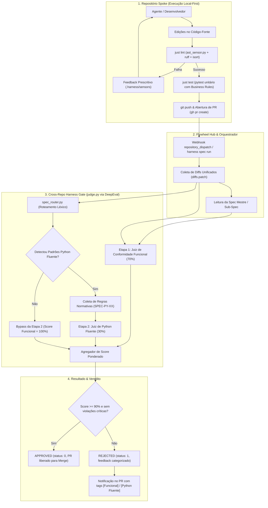
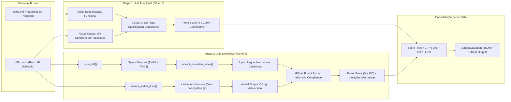
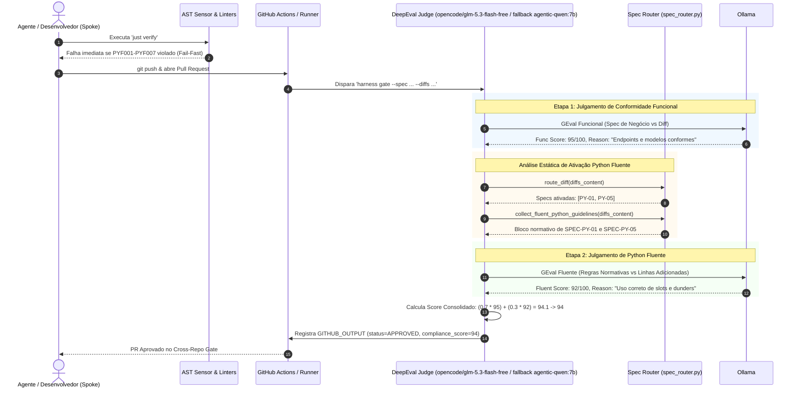
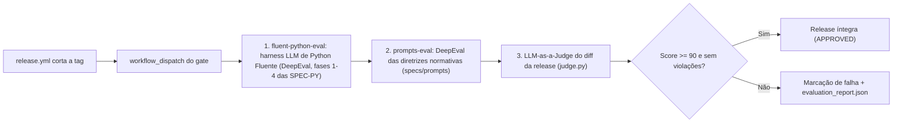

# Fluxo Canônico de Avaliação de Código: Staged Code Evaluation & Cross-Repo Gate

> **Documento Oficial de Arquitetura e Engenharia de Avaliação de Código.**  
> Este documento formaliza o pipeline canônico de avaliação de código da plataforma SDD federada (**harness-state** como núcleo autovalidador), detalhando o desacoplamento em camadas determinísticas e cognitivas, o papel do **Roteador Estático de Especificações**, a **avaliação em etapas especializadas (Staged LLM-as-a-Judge)** e a mitigação de sobrecarga de contexto para modelos locais (como o `agentic-qwen:7b`).

---

## 1. Visão Geral e Motivação Arquitetural

A avaliação de código gerado por agentes de IA ou engenheiros de software em um ecossistema federado distribuído impõe desafios fundamentais de precisão, custo computacional e latência:

1. **Heterogeneidade de Objetivos Cognitivos:** Uma alteração de código precisa ser avaliada simultaneamente quanto a:
   - **Conformidade Funcional:** Os endpoints, regras de negócio e modelos de dados solicitados na especificação foram entregues?
   - **Integridade de Testes:** Os testes unitários comprovam as regras de negócio com docstrings padronizadas (`Business Rule:`)?
   - **Conformidade Idiomática e Qualidade:** O código segue os padrões canônicos da linguagem (ex: *Python Fluente*), evitando anti-padrões e dívidas técnicas?
2. **Gargalo de Contexto e Atenção em Modelos Locais (7B Parameters):** Modelos de código locais hospedados em Ollama (como `agentic-qwen:7b`) sofrem de **degradação severa de atenção ("Lost in the Middle")** quando submetidos a prompts monolíticos gigantescos contendo diffs multi-repositório agregados somados a dezenas de páginas de especificações. O resultado são notas imprecisas, alucinações e aprovações superficiais.
3. **Princípio do Fail-Fast Determinístico:** Regras que podem ser validadas por análise léxica ou de AST em frações de segundo nunca devem consumir tokens de modelos de linguagem.

A solução adotada pelo ecossistema é o **Pipeline de Avaliação em Três Camadas com Julgamento em Etapas Especializadas (Staged Evaluation)**.

---

## 2. Diagramas de Arquitetura

### 2.1. Topologia Completa do Fluxo de Avaliação

O diagrama abaixo ilustra o ciclo de vida completo de uma alteração de código, desde a edição local no spoke até o veredito final emitido pelo Cross-Repo Gate.

---

### 2.2. Arquitetura Interna do Avaliador em Etapas (`judge.py`)

O desacoplamento de prompts garante que o modelo LLM receba apenas o subconjunto de informações estritamente relevante para a métrica que está avaliando:

---

### 2.3. Diagrama de Sequência Temporal da Avaliação

---

### 2.4. Sequência Canônica de Etapas de LLM na Produção de Release

Na esteira do **harness-state** (núcleo autovalidador), as chamadas de LLM
ocorrem **exclusivamente durante a produção de um novo release** — nunca em
PRs, onde apenas camadas determinísticas validam (sensores AST PYF, ruff,
isort, pyright, pytest sem rede). Quando `release.yml` corta a tag, o gate de
autoavaliação é disparado como **último passo** do job via
`workflow_dispatch` (`GITHUB_TOKEN` com `actions: write`), com a seguinte
ordem obrigatória:

* **Por que o harness de Python Fluente vem antes do juiz:** as suítes
  `tests/evals/test_fluent_python_phase*.py` validam as próprias specs
  normativas (SPEC-PY-*) que o `spec_router.py` injeta na Etapa 2 do juiz.
  Julgar o diff da release com diretrizes não verificadas seria emitir
  veredito sobre régua potencialmente torta; a cadeia falha cedo (jobs com
  `needs`), economizando o endpoint e preservando a auditabilidade.
* **O juiz avalia o diff da release contra este documento**
  (`docs/architecture/code-evaluation-flow.md`): mudanças na topologia da
  esteira (novos jobs, nova ordem de execução) exigem emendar este spec na
  mesma release — caso contrário o veredito legítimo é REJECTED por
  desvio de arquitetura.
* O gate **nunca bloqueia** a notificação `core-released` ao flywheel: por
  isso o dispatch do gate é o último passo do job de release.

---

## 3. Detalhamento das Três Camadas de Avaliação

### 3.1. Camada 1: Sensores Determinísticos Locais (Fail-Fast Estático)

Os sensores embutidos no catálogo (`.harness/sensors/`) operam por análise sintática da Árvore Sintática Abstrata (AST) do Python, executando em milissegundos sem custos de inferência de LLM:

| Código | Descrição da Regra | Fonte Canônica | Ação do Sensor |
| :--- | :--- | :--- | :--- |
| `PYF001` | Proibição de funções aninhadas (exceto decoradores indispensáveis). | *Python Code Organization* | Erro sintático imediato. |
| `PYF002` | Proibição de herança de built-ins (`dict`, `list`, `str`). | `SPEC-PY-03` | Requer composição ou `collections.UserDict`. |
| `PYF003` | Métodos de comparação (`__eq__`, `__lt__`) devem retornar `NotImplemented` e não levantar `TypeError`. | `SPEC-PY-10` | Validação de retorno nos nós `ast.FunctionDef`. |
| `PYF004` | Proibição de argumentos padrão mutáveis (`[]`, `{}`). | `SPEC-PY-06` | Validação de `node.args.defaults` e `kw_defaults`. |
| `PYF005` | Proibição estrita de blocos `try...except` aninhados (*No Nested Try-Excepts*). | *Python Code Style* | Monitoramento de profundidade `try_depth > 0`. |
| `PYF006` | Proibição de `try...except` envolvendo instruções de importação estática. | *Python Imports Rule* | Validação de nós `ast.Import` e `ast.ImportFrom`. |
| `PYF007` | Proibição de prefixo `_` em variáveis e funções soltas fora de classes. | *Non-Class Members Rule* | Verificação em `ast.FunctionDef`, `Assign` e `AnnAssign`. |

---

### 3.2. Camada 2: Roteador Estático de Especificações (`spec_router.py`)

O `spec_router.py` processa o diff textual unificado utilizando expressões regulares compiladas para categorizar as alterações nos 5 Grupos Temáticos:
- **Grupo A (Estruturas de Dados e Objetos):** `PY-01` (Data Model), `PY-02` (Sequences), `PY-03` (Dicts/Sets), `PY-05` (Dataclasses), `PY-06` (Mutabilidade).
- **Grupo B (Funções e Tipagem):** `PY-07` (Decorators/Closures), `PY-08` (Type Hints).
- **Grupo C (Orientação a Objetos e Interfaces):** `PY-09` (Protocols/ABCs), `PY-10` (Operator Overloading).
- **Grupo D (Fluxo de Controle e Concorrência):** `PY-04` (Text/Bytes), `PY-11` (Generators/Context), `PY-12` (Async/Concurrency).
- **Grupo E (Metaprogramação):** `PY-13` (Metaprogramming & Dynamic Attributes).

#### Funções de Extração Cirúrgica:
- `extract_added_lines(diff_text: str) -> str`: Remove metadados do patch (`--- a/`, `+++ b/`, `@@`) e linhas excluídas, entregando apenas código novo para o LLM.
- `extract_normative_rules(spec_markdown: str) -> str`: Isola a seção `## 2. Regras normativas` do arquivo `SPEC-PY-XX.md`, descartando contextualizações bibliográficas e exemplos extensos.
- `collect_fluent_python_guidelines(diff_text: str) -> str`: Consolida em formato Markdown de alta densidade as regras normativas aplicáveis às alterações detectadas.

---

### 3.3. Camada 3: Avaliador LLM em Etapas Especializadas (`judge.py`)

O `judge.py` atua como o juiz final no Cross-Repo Gate utilizando o framework DeepEval com o tier padrão OpenCode `opencode/glm-5.3-flash-free` e fallback para `agentic-qwen` quando os recursos primários se esgotarem:

#### Etapa 1: Avaliação de Conformidade Funcional
- **Métrica:** `build_gate_metric` (`GEval`).
- **Input:** Especificação funcional (`spec_content`).
- **Actual Output:** Diff consolidado dos repositórios (`diffs_content`), compactado
  cirurgicamente por arquivo (`compact_diff_for_functional_stage`) para respeitar o
  orçamento de ~3.000 tokens por chamada: diffs pequenos seguem íntegros; diffs
  multi-arquivo entregam linhas adicionadas compactadas (início/fim de cada arquivo)
  com prioridade para código-fonte, depois testes e documentação, mantendo todos os
  caminhos visíveis ao juiz.
- **Critérios Avaliados:**
  1. Presença de todos os modelos, entidades e regras de negócio exigidas pela especificação.
  2. Conformidade das assinaturas de métodos e endpoints de API.
  3. Existência de testes unitários com docstrings descritivas no formato `Business Rule: <regra>`.
- **Peso:** 70% da pontuação total.

#### Etapa 2: Avaliação de Conformidade Idiomática (Python Fluente)
- **Métrica:** `build_fluent_python_metric` (`GEval`).
- **Condição de Execução:** Disparada exclusivamente quando `collect_fluent_python_guidelines` detecta padrões ativados em arquivos Python.
- **Input:** Regras normativas concisas das specs de Python Fluente acionadas.
- **Actual Output:** Apenas o código adicionado (`extract_added_lines`).
- **Critérios Avaliados:**
  1. Utilização dos métodos especiais do Python Data Model sobre métodos convencionais arbitrários.
  2. Adesão aos contratos de imutabilidade, `@dataclass(slots=True)` e boas práticas de tipagem.
  3. Ausência de anti-padrões e violações explícitas de convenções idiomáticas.
- **Peso:** 30% da pontuação total.

#### Consolidação e Regras de Aprovação
$$\text{Score Consolidado} = 0.7 \times \text{Score}_{\text{Funcional}} + 0.3 \times \text{Score}_{\text{Fluente}}$$

- O PR só é marcado como **`APPROVED`** se:
  1. A avaliação funcional for aprovada (`is_successful=True` e `Score >= 90`).
  2. A avaliação de Python Fluente (quando aplicável) for aprovada (`is_successful=True` e `Score >= 90`).
  3. O score consolidado ponderado for $\ge 90/100$.
- Caso qualquer etapa reprove, o relatório em JSON e a saída do terminal destacam as falhas com prefixos semânticos explícitos:
  - `[Funcional] O endpoint POST /pedidos não trata o payload com validação de estoque.`
  - `[Python Fluente] A classe Pedido viola a SPEC-PY-01 ao não implementar __repr__ canônico.`

---

## 4. Benefícios Práticos para o Ecossistema

1. **Zero Falso-Positivo por Truncamento:** A divisão cirúrgica mantém as chamadas ao Ollama abaixo de 3.000 tokens cada, garantindo 100% de precisão de leitura na GPU.
2. **Diagnóstico Imediato:** Agentes autônomos recebem feedback prescritivo claro, sabendo se precisam ajustar testes, implementar requisitos de negócio ou refatorar o código para padrões pythônicos.
3. **Economia Computacional:** Diffs que não contêm Python ignoram a Etapa 2 sem overhead de inferência.
4. **Governança Unificada:** O mesmo motor de julgamento é invocado tanto no runner desatendido da nuvem quanto na execução local via `harness spec run specs/SPEC-XXX.md`.
