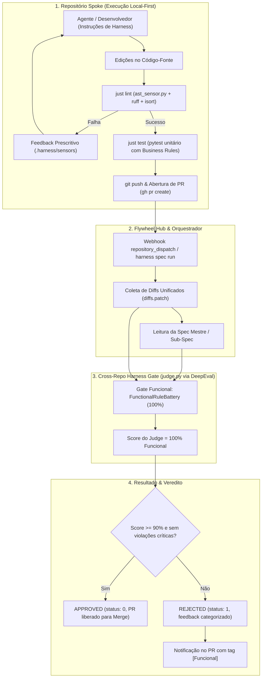
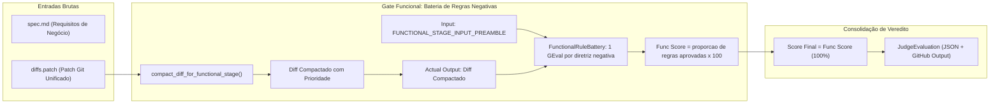
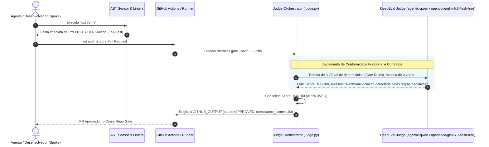

# Fluxo Canônico de Avaliação de Código: Staged Code Evaluation & Cross-Repo Gate

> **Documento Oficial de Arquitetura e Engenharia de Avaliação de Código.**  
> Este documento formaliza o pipeline canônico de avaliação de código da plataforma SDD federada (**harness-state** como núcleo autovalidador), detalhando o desacoplamento em camadas determinísticas e cognitivas, o papel do **Roteador Estático de Especificações**, a **avaliação focada no Gate Funcional (LLM-as-a-Judge)** e a governança de código fluente via instruções de harness e sensores AST determinísticos.

---

## 1. Visão Geral e Motivação Arquitetural

> **Sequência canônica normativa (produção de release, LLM — gate
> SÍNCRONO pré-corte):** o `release.yml` flui em três jobs encadeados:
> `release-candidate` calcula a versão candidata (Conventional Commits);
> `pre-release-eval` CHAMA (workflow_call) o `tag-code-evaluation.yml`
> com a tag candidata ainda inexistente, que executa em ordem
> obrigatória **1)** `fluent-python-eval` — o harness de Python Fluente
> dependente de LLM (DeepEval, `tests/evals/test_fluent_python_phase1-4.py`)
> valida as specs SPEC-PY que servem de régua ao ecossistema; **2)**
> `prompts-eval` — DeepEval das diretrizes `specs/prompts/`; **3)** o
> `judge.py` emite o veredito sobre `git diff LATEST_TAG..HEAD`
> (conteúdo idêntico ao que seria taggeado; APPROVED >= 90). Só então o
> `tag-and-release` corta a tag, publica a GitHub Release e notifica o
> flywheel (`core-released`). Veredito REJECTED ou falha de avaliação
> BLOQUEIA o corte (job posterior skipped) — a release só existe com o
> núcleo aprovado pelo juiz. Em PRs não há chamadas de LLM (apenas
> camadas determinísticas: sensores AST PYF, ruff, isort, pyright,
> pytest). Alterações de topologia/ordem da esteira de release exigem
> emenda simultânea a esta seção — o juiz mede o diff contra ela; diffs
> puramente documentais/de manutenção são acolhidos pela regra de
> isenção (skip não-código / manutenção).

A avaliação de código gerado por agentes de IA ou engenheiros de software em um ecossistema federado distribuído impõe desafios fundamentais de precisão, custo computacional e latência:

1. **Heterogeneidade de Objetivos Cognitivos:** Uma alteração de código precisa ser avaliada simultaneamente quanto a:
   - **Conformidade Funcional e Contratos:** Os endpoints, regras de negócio e modelos de dados solicitados na especificação foram entregues sem regressão ou quebra de contratos públicos?
   - **Integridade de Testes:** Os testes unitários comprovam as regras de negócio com docstrings padronizadas (`Business Rule:`)?
   - **Conformidade Idiomática via Instruções de Harness:** Padrões pythônicos e normas idiomáticas são ensinados aos agentes via instruções de harness (skills, prompts de sistema, `AGENTS.md`) e validados de ponta a ponta por sensores determinísticos AST (`PYF001-PYF007`), linters e testes, sem submeter fragmentos desconexos de diff a alucinações de modelos LLM.
2. **Gargalo de Contexto e Atenção em Modelos Locais (7B Parameters):** Modelos de código locais hospedados em Ollama (como `agentic-qwen:7b`) sofrem de **degradação severa de atenção ("Lost in the Middle")** quando submetidos a prompts monolíticos gigantescos contendo diffs multi-repositório agregados somados a dezenas de páginas de especificações. O resultado são notas imprecisas, alucinações de indentação/sintaxe e falsos positivos.
3. **Princípio do Fail-Fast Determinístico:** Regras que podem ser validadas por análise léxica ou de AST em frações de segundo nunca devem consumir tokens de modelos de linguagem nem travar entregas por falsos positivos de estilo em diffs.

A solução adotada pelo ecossistema é o **Pipeline de Avaliação Desacoplado: Julgamento Funcional pelo Judge e Padrões Idiomáticos por Instruções de Harness e Sensores AST**.

---

## 2. Diagramas de Arquitetura

### 2.1. Topologia Completa do Fluxo de Avaliação

O diagrama abaixo ilustra o ciclo de vida completo de uma alteração de código, desde a edição local no spoke até o veredito final emitido pelo Cross-Repo Gate.

---

### 2.2. Arquitetura Interna do Avaliador de Gate (`judge.py`)

O desacoplamento de prompts garante que o modelo LLM receba apenas o subconjunto de informações estritamente relevante para a métrica que está avaliando:

---

### 2.3. Diagrama de Sequência Temporal da Avaliação

---

## 3. Detalhamento das Três Camadas de Avaliação

### 3.1. Camada 1: Sensores Determinísticos Locais (Fail-Fast Estático)

Os sensores embutidos no catálogo (`.harness/sensors/`) operam por análise sintática da Árvore Sintática Abstrata (AST) do Python, executando em milissegundos sem custos de inferência de LLM:

| Código | Descrição da Regra | Fonte Canônica | Ação do Sensor |
| :--- | :--- | :--- | :--- |
| `PYF001` | Proibição de funções aninhadas (exceto decoradores indispensáveis). | *Python Code Organization* | Erro sintático imediato. |
| `PYF002` | Proibição de herança de built-ins (`dict`, `list`, `str`). | `SPEC-PY-03` | Requer composição ou `collections.UserDict`. |
| `PYF003` | Métodos de comparação (`__eq__`, `__lt__`) devem retornar `NotImplemented` e não levantar `TypeError`. | `SPEC-PY-10` | Validação de retorno nos nós `ast.FunctionDef`. |
| `PYF004` | Proibição de argumentos padrão mutáveis (`[]`, `{}`). | `SPEC-PY-06` | Validação de `node.args.defaults` e `kw_defaults`. |
| `PYF005` | Proibição estrita de blocos `try...except` aninhados (*No Nested Try-Excepts*). | *Python Code Style* | Monitoramento de profundidade `try_depth > 0`. |
| `PYF006` | Proibição de `try...except` envolvendo instruções de importação estática. | *Python Imports Rule* | Validação de nós `ast.Import` e `ast.ImportFrom`. |
| `PYF007` | Proibição de prefixo `_` em variáveis e funções soltas fora de classes. | *Non-Class Members Rule* | Verificação em `ast.FunctionDef`, `Assign` e `AnnAssign`. |

---

### 3.2. Camada 2: Roteador Estático de Especificações (`spec_router.py`)

O `spec_router.py` processa o diff textual unificado utilizando expressões regulares compiladas para categorizar as alterações nos 5 Grupos Temáticos:
- **Grupo A (Estruturas de Dados e Objetos):** `PY-01` (Data Model), `PY-02` (Sequences), `PY-03` (Dicts/Sets), `PY-05` (Dataclasses), `PY-06` (Mutabilidade).
- **Grupo B (Funções e Tipagem):** `PY-07` (Decorators/Closures), `PY-08` (Type Hints).
- **Grupo C (Orientação a Objetos e Interfaces):** `PY-09` (Protocols/ABCs), `PY-10` (Operator Overloading).
- **Grupo D (Fluxo de Controle e Concorrência):** `PY-04` (Text/Bytes), `PY-11` (Generators/Context), `PY-12` (Async/Concurrency).
- **Grupo E (Metaprogramação):** `PY-13` (Metaprogramming & Dynamic Attributes).

#### Funções de Extração Cirúrgica:
- `extract_added_lines(diff_text: str) -> str`: Remove metadados do patch (`--- a/`, `+++ b/`, `@@`) e linhas excluídas, entregando apenas código novo para o LLM.
- `extract_normative_rules(spec_markdown: str) -> str`: Isola a seção `## 2. Regras normativas` do arquivo `SPEC-PY-XX.md`, descartando contextualizações bibliográficas e exemplos extensos.
- `collect_fluent_python_guidelines(diff_text: str) -> str`: Consolida em formato Markdown de alta densidade as regras normativas aplicáveis às alterações detectadas.

---

### 3.3. Camada 3: Avaliador LLM em Etapas Especializadas (`judge.py`)

O `judge.py` atua como o juiz final no Cross-Repo Gate utilizando o framework DeepEval. Os tiers são resolvidos pela config de servidor (envs canônicas): primário `LLM_JUDGE_MODEL` (neste repositório, `agentic-qwen`), fallback `LLM_JUDGE_FALLBACK_MODEL`; `opencode/glm-5.3-flash-free` permanece apenas como constante de último recurso `JUDGE_DEFAULT_MODEL`:

#### Etapa 1: Avaliação de Conformidade Funcional (Bateria de Regras Negativas)
- **Métrica:** `build_gate_metric` devolve uma `FunctionalRuleBattery`: uma GEval de
  **diretriz única e negativa** por regra normativa (fábrica `build_single_rule_metric`,
  limiar 0.9), agregada por **maioria de 3 votos por regra** (`measure_metric_with_majority`).
- **Regras normativas fiscalizadas** (`FUNCTIONAL_GATE_RULES`) — as únicas capazes de
  reprovar a Etapa 1:
  1. **Integridade de Gates de Qualidade:** o patch não apaga nem enfraquece testes,
     asserções ou gates para fazer a pipeline passar; substituir um canal de avaliação
     comprovadamente não-confiável por um mais estrito e validado é conforme.
  2. **Proibição de Mascaramento de Erros** (RCA canônico): nada de `try/except`,
     supressões silenciosas ou mocks artificiais que escondem a causa raiz.
  3. **Preservação de Contratos Públicos:** assinaturas, comandos de CLI, formatos de
     dados persistidos e fluxos documentados não mudam sem atualizar dependentes e spec.
- **Input:** O framing fixo `FUNCTIONAL_STAGE_INPUT_PREAMBLE`, que declara o diff
  como único material avaliado e estipula que **ausência de alinhamento com
  especificação não é violação** de diretriz negativa. A spec **não** entra no
  contexto do juiz da Etapa 1: com ela presente (preview 43633346713), o modelo
  local tratou "não alinhar com a especificação" como violação das três regras
  (3×0/100) — em modelos pequenos não existe "contexto apenas"; e em diffs meta
  a linguagem da spec contamina a pergunta. A verificação de cobertura dos
  requisitos funcionais da spec pertence aos gates determinísticos (ciclo de
  vida spec-hub, suíte de testes), não ao LLM.
- **Actual Output:** Diff consolidado (`diffs_content`), compactado cirurgicamente por
  arquivo (`compact_diff_for_functional_stage`) para respeitar o orçamento de ~3.000
  tokens por chamada: diffs pequenos seguem íntegros; diffs multi-arquivo entregam
  linhas adicionadas compactadas (início/fim de cada arquivo) com prioridade para
  código-fonte, depois testes e documentação, mantendo todos os caminhos visíveis ao juiz.
- **Critério de Aprovação:** todas as regras aprovadas por maioria; o score é a
  proporção de regras aprovadas × 100 e cada regra reprovada é reportada nominalmente
  com prefixo `[Funcional]`.
- **Robustez do medidor (não mascaramento):** um voto cujo output do juiz viole o
  contrato JSON do DeepEval é erro de *medição*, não veredito de conformidade — o voto
  é re-tentado (`collect_metric_vote`, 2 tentativas). Exauridas as tentativas, a
  exceção propaga e o tier falha de forma audível no relatório. Rejeições legítimas
  nunca são re-tentadas (vêm como voto, não como exceção).
- **Fundamento (evidência, não palpite):** o desenho anterior — um único GEval absoluto
  de alinhamento spec↔diff — provou-se **bimodal** nos previews com dois modelos
  (`gemma4:e2b`: 10/False repetido contra um motivo que elogiava as mudanças;
  `qwen2.5-coder:14b`: 0/False em diff meta, lendo o patch como "resposta que deveria
  conter uma avaliação"). Modelos locais confundem instrução e dado quando spec e diff
  tratam do mesmo assunto (release que altera o próprio pipeline de avaliação). O canal
  **negativo de diretriz única** — o mesmo do RCA, estável em todas as corridas das
  suítes (`tests/evals/`) — pergunta apenas se HÁ violação detectável, e a fábrica
  proíbe penalizar ausência de demonstração.
- **Peso:** 100% da pontuação do juiz.

#### Governança de Código Idiomático (Python Fluente) via Harness e Sensores
- **Instruções de Harness para Agentes:** As especificações e regras de código idiomático (Python Fluente) são integradas diretamente como prompts e convenções nos harnesses e módulos. Os agentes geradores de código são instruídos antecipadamente a produzir classes imutáveis, métodos especiais do Data Model e ausência de anti-padrões.
- **Sensores Estáticos Locais e no CI:** A conformidade com as regras de Python Fluente (`PYF001-PYF007`) é auditada de forma determinística e imediata pelos sensores AST (`ast_sensor.py`), executados junto com os testes unitários (`test.yml`).
- **Isenção do Judge LLM:** O módulo `judge.py` não executa etapa de avaliação de estilo ou sintaxe por LLM sobre diffs, eliminando falsos positivos decorrentes de fragmentos de código e mantendo seu foco estritamente na conformidade funcional e de contratos.

#### Consolidação e Regras de Aprovação
$$\text{Score do Judge} = \text{Score}_{\text{Funcional}} \quad (100\%)$$

- O PR só é marcado como **`APPROVED`** se:
  1. A avaliação funcional da especificação for aprovada (`is_successful=True` e `Score >= 90`).
  2. Todos os testes unitários e sensores estáticos determinísticos passarem no CI.
- Caso o Gate funcional reprove, o relatório em JSON e a saída do terminal destacam as falhas com o prefixo:
  - `[Funcional] O endpoint POST /pedidos quebra a assinatura pública do contrato.`

---

## 4. Benefícios Práticos para o Ecossistema

1. **Zero Falso-Positivo por Truncamento:** A divisão cirúrgica mantém as chamadas ao Ollama abaixo de 3.000 tokens cada, garantindo 100% de precisão de leitura na GPU.
2. **Diagnóstico Imediato:** Agentes autônomos recebem feedback prescritivo claro, sabendo se precisam ajustar testes, implementar requisitos de negócio ou refatorar o código para padrões pythônicos.
3. **Economia Computacional:** Diffs que não contêm Python ignoram a Etapa 2 sem overhead de inferência.
4. **Governança Unificada:** O mesmo motor de julgamento é invocado tanto no runner desatendido da nuvem quanto na execução local via `harness spec run specs/SPEC-XXX.md`.
