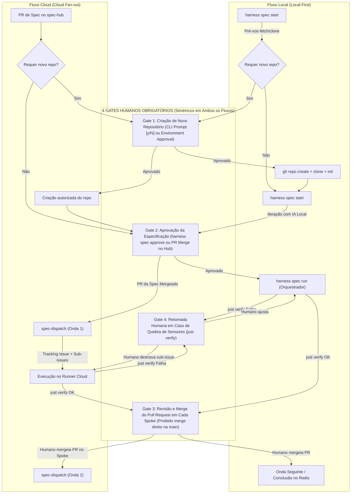

# Arquitetura e Especificação: Plataforma de Harness SDD Federada & harness-state

> **Documento Oficial de Arquitetura e Governança do Ecossistema.**  
> Este documento formaliza o modelo de **Spec-Driven Development (SDD) Federado com Governança Centralizada de Capacidades, Specs Descentralizadas por Módulo e Orquestração Simétrica Local/Remota**, aplicando os princípios de *Humans on the Loop* e *Cybernetic Regulation* (Thoughtworks).

---

## 1. Visão Geral e Princípios Fundamentais

A plataforma resolve o desafio do desenvolvimento distribuído entre múltiplos repositórios e serviços através de seis princípios inegociáveis:

1. **Separação Canônica entre Intenção e Implementação:** O código nunca é modificado diretamente para iniciar uma nova funcionalidade. O ponto de partida é sempre uma especificação formalizada e versionada.
2. **Spec Mestre Centralizada (SSOT no Spec-Hub) com Fan-Out Cirúrgico e Sincronização Reversa (Sync-Back):**
   - **No `<project>-spec-hub` (`<project>-spec-hub/specs/` — Fonte Única da Verdade / SSOT):** Toda especificação técnica de arquitetura (`SPEC-XXX`) nasce e é aprovada formalmente no `spec-hub`, correlacionando o catálogo de produtos (`products/`), as capacidades de negócio (`capabilities/`) e o grafo topológico (`manifest.yaml`).
   - **Nos Repositórios Spokes (`<spoke>/specs/<spec_id>.md` — Sub-Specs Cirúrgicas):** Durante o planejamento (`harness spec plan`) ou execução (`harness spec run`), a spec mestre é decomposta cirurgicamente em sub-specs autocontidas e distribuídas para os spokes impactados. Se uma spec altera 3 repositórios, são geradas 3 specs diferentes, contendo estritamente o escopo, contratos e cenários pertinentes a cada repositório.
   - **Sincronização Reversa (Sync-Back / Spoke ➔ Hub):** Qualquer refinamento ou modificação realizada localmente na sub-spec do spoke é reconciliada cirurgicamente de volta para a spec mestre no `spec-hub` (`harness spec sync-hub`), preservando a integridade do SSOT sem sobrescrever as seções dos demais repositórios.
3. **Separação dos Harnesses em Dois Tipos (Unificados no Catálogo do `harness-state`):**
   - **Tipo 1 — Harness Cognitivo (Skills Locais):** Regras de engenharia, padrões de arquitetura e playbooks de TDD carregados pelo agente local como skills (`.claude/skills/`).
   - **Tipo 2 — Harness de Pipeline de Verificação Semi-Automatizado:** `justfile`, sensores determinísticos (`.harness/sensors/format_feedback.sh`), linters, checagem de tipos e contratos de arquitetura executados tanto localmente quanto no CI.
   - Ambos os tipos ficam hospedados centralmente no catálogo do repositório **`eduardosan/harness-state`** e são distribuídos para a raiz do pacote local através do comando **`harness init`**.
4. **Motor Único de Orquestração Simétrica (`harness spec run` Local Semi-Automatizado vs. Cloud CI/CD):**
   - Os fluxos **Local-First** e **Remoto/Cloud** compartilham **a mesma máquina de estados canônica (`harness_state.orchestrator`)**, expondo a CLI unificada **`harness`**.
   - **No Fluxo Local:** Para evitar que o desenvolvedor ou agente local precise memorizar sequências de comandos, o comando **`harness spec run specs/SPEC-XXX.md`** atua como um **CI/CD local semi-automatizado**, conduzindo todas as 6 atividades canônicas (`init` ➔ `plan` ➔ `resume` ➔ `verify` ➔ `gate` ➔ `sync-hub`) passo a passo.
   - **No Fluxo Remoto (Cloud):** Workflows de CI/CD e Runners remotos invocam a mesma máquina de estados em modo desatendido (`harness spec run --ci` / `harness bug run --ci` com agentes headless e controle de concorrência).
5. **Ambientes Herméticos com Dockerfile Customizado por Projeto:** A extração de AST, validação de tipos e testes utilizam a imagem Docker do próprio repositório alvo (via Dagger), eliminando contaminação do ambiente host.
6. **State Tracker Centralizado (Barramento Redis):** A máquina de estados da especificação (`SPEC-ID -> [repos, branches, PRs, ondas, checklist]`) é mantida em um barramento central Redis (acessível diretamente ou via túnel SSH seguro), permitindo iniciar o trabalho no desktop, continuar no notebook ou delegar para o runner da nuvem sem perder contexto.

---

## 2. Topologia de Repositórios e Responsabilidades

```
┌──────────────────────────────────────────────────────────────────────────────────────┐
│ 1. eduardosan/harness-state (Núcleo Canônico: CLI `harness` + State + Gates + Judge) │
│    • Catálogo Unificado:                                                             │
│      - Harness Tipo 1 (Skills Locais por linguagem: Python, Go, TS, Common)          │
│      - Harness Tipo 2 (Pipeline Semi-Automatizado: justfile + format_feedback.sh)    │
│    • Orquestrador Local Semi-Automatizado & Remoto (`harness init` e `harness spec run`)  │
│    • State Tracker Redis (`harness_state.state`) + Domain Inspector (`harness_state.catalog`)│
│    • Cross-Repo Gate & LLM-as-a-Judge (`harness_state.gate` / `harness_state.judge`) │
│    • Sensores Determinísticos, Auditoria de Dados e Gestão de Prompts                │
└───────────────────┬──────────────────────────────────────────────┬───────────────────┘
                    │ `harness init` & `harness spec run`               │ Sincroniza capacidades
                    │ operam nos módulos locais e na cloud         │ e contratos DDD
                    ▼                                              ▼
┌─────────────────────────────────────────┐    ┌───────────────────────────────────────┐
│ 3. Módulos / Spokes (ex: repo-service)  │    │ 2. <project>-spec-hub                 │
│    • `specs/SPEC-XXX.md` ("O que faz")  │───►│    (Governança - "Quem faz o quê")    │
│    • `.claude/skills/<lang>-*/SKILL.md` │    │    • `products/*.yaml`                │
│    • `.harness/sensors/` + `justfile`   │    │    • `capabilities/*/capability.yaml` │
│    • `Dockerfile` customizado           │    │    • `manifest.yaml` (Grafo e Ondas)  │
│    • Código da aplicação e testes       │    └───────────────────────────────────────┘
└─────────────────────────────────────────┘
```

### 2.1. Funções Detalhadas de Cada Repositório

1. **`eduardosan/harness-state` (Núcleo Canônico — CLI `harness` Local & Esteira Cloud):**
   - **Catálogo Unificado de Harnesses:** Hospeda os **Harnesses Cognitivos (Skills Locais)** e os **Harnesses do Pipeline de Verificação Semi-Automatizado** por linguagem (`python`, `go`, `typescript`, `common`).
   - **Bootstrap Local (`harness init`):** Detecta automaticamente a linguagem do módulo local (`pyproject.toml`, `go.mod`, `package.json`) e baixa para a raiz do pacote todas as skills da linguagem (`.claude/skills/`), o pipeline de verificação (`justfile`, `.harness/sensors/format_feedback.sh`) e a pasta `specs/`.
   - **Orquestrador Semi-Automatizado (`harness spec run`):** Motor de esteira guiado por estado (`harness_state.orchestrator`) que executa a sequência completa de atividades localmente de forma semi-automatizada e na nuvem de forma 100% autônoma (`--ci`), persistindo o progresso no barramento de estado (Redis).
   - **Execução Cloud, Gate e Auditoria:** Executa o **Cross-Repo Harness Gate** (`harness_state.gate` + `harness_state.judge`), coleta telemetria no Elasticsearch e gerencia a governança e promoção atômica de prompts para o Langfuse.

2. **`<project>-spec-hub` (Governança Central e Fonte Única da Verdade — SSOT):**
   - Centraliza o `manifest.yaml` (lista de repositórios do ecossistema, ondas e dependências), o catálogo de produtos (`products/`), o mapa de capacidades (`capabilities/`) e a **pasta de especificações mestres (`specs/SPEC-XXX.md`)**.
   - **Hospeda as especificações mestres de arquitetura como SSOT:** atua como a autoridade central onde nascem as especificações transversais completas. A partir do hub, o orquestrador executa o **fan-out cirúrgico** (`harness spec fanout`), fatiando a spec mestre em sub-specs autocontidas para cada módulo afetado, e o **sync-back** (`harness spec sync-hub`), reconciliando de volta qualquer evolução local.

3. **Repositórios Módulos / Spokes (`repo-service-*` — "O que ele faz"):**
   - Contêm o código-fonte da aplicação, seus testes unitários/integração e seu `Dockerfile` customizado de produção/desenvolvimento.
   - **Hospedam suas sub-especificações cirúrgicas em `specs/<spec_id>.md`:** Cada spoke recebe exclusivamente a fatia de escopo, contratos e cenários Gherkin pertinentes a ele, evitando ruído de outros repositórios. Caso o desenvolvedor ou agente refine a especificação localmente no spoke, a sincronização reversa (`harness spec sync-hub`) propaga as melhorias de volta para a spec mestre no hub.
   - Recebem na raiz, via `harness init`, as skills da sua linguagem (`.claude/skills/`) e o pipeline de verificação (`justfile` + `.harness/sensors/`).

4. **`eduardosan/agentic-flywheel` (Execution Engine):**
   - Motor de execução enxuto e orquestrador de execução de agentes de IA locais e remotos, consumindo os módulos canônicos do `harness-state`.

---

## 3. Decomposição Detalhada dos Subsistemas da Plataforma

### A. A Hierarquia DDD: Produtos, Business Capabilities e o Domain Inspector (`harness_state.catalog`)

* **Fundamento Domain-Driven Design (DDD) em Três Camadas Estratégicas:**
  A plataforma organiza o ecossistema distribuído em três camadas ontológicas claras, separando a governança estratégica (no `<project>-spec-hub`) das especificações técnicas (nos módulos de origem):

  ```
  ┌────────────────────────────────────────────────────────┐
  │           1. Produtos (Core Domains de Clientes)       │
  │  No <project>-spec-hub: products/<product-id>.yaml     │
  └───────────────────────────┬────────────────────────────┘
                              │ consome / orquestra
                              ▼
  ┌────────────────────────────────────────────────────────┐
  │         2. Business Capabilities (Bounded Contexts)    │
  │  No <project>-spec-hub: capabilities/<id>/capability   │
  └───────────────────────────┬────────────────────────────┘
                              │ implementa em incrementos
                              ▼
  ┌────────────────────────────────────────────────────────┐
  │    3. Especificações Mestres no Hub (SSOT da Spec)     │
  │  No <project>-spec-hub: specs/SPEC-XXX.md              │
  │  (Visão holística de produto, escopos e contratos)     │
  └─────────────┬───────────────────────────▲──────────────┘
                │                           │
  harness spec fanout (cirúrgico)     harness spec sync-hub (sync-back)
                │                           │
                ▼                           │
  ┌─────────────────────────────────────────┴──────────────┐
  │    4. Sub-specs Cirúrgicas nos Módulos / Spokes        │
  │  No Spoke: <modulo>/specs/SPEC-XXX.md                  │
  │  (Fatia autocontida: Escopo H3, Contratos H3 e Gherkin)│
  └────────────────────────────────────────────────────────┘
  ```

  1. **Produtos & Core Domains de Clientes (`<project>-spec-hub/products/<product-id>.yaml`):**
     Representa a solução de valor entregue a clientes de segmentos distintos. Mapeia o segmento de mercado (`client_segment`), os repositórios que compõem a solução e a lista de capacidades consumidas.
  2. **Business Capabilities (Bounded Contexts) (`<project>-spec-hub/capabilities/<capability-id>/capability.yaml`):**
     Habilidade corporativa estável do sistema (ex: CRM, Agendamento, Mensageria Omnichannel).
     - **Escopo (`scope`):** `platform` (transversal/compartilhada entre múltiplos produtos) ou `product-specific` (dedicada a um segmento de cliente específico).
     - **Produtos Suportados (`supported_products`):** Lista de produtos atendidos pela capacidade.
     - **Linguagem Ubíqua (`ubiquitous_language`):** Vocabulário ontológico oficial do domínio.
     - **Context Mapping (`context_map`):** Autoridade upstream, camada de SDK e consumidores downstream.
     - **Contratos de Runtime (`runtime_contracts`):** Classes e métodos públicos implementados no código real dos módulos.
     - **Histórico de Specs (`implemented_specs`):** Referências cruzadas para as specs que construíram ou evoluíram a capacidade.
  3. **Especificações Mestres no Hub (`<project>-spec-hub/specs/SPEC-XXX.md`):**
     A especificação mestre completa reside na pasta `specs/` do spec-hub, constituindo a Fonte Única da Verdade (SSOT). Ela detalha o problema global, as seções de escopo e contratos H3 de cada repositório afetado e os critérios de aceitação.
  4. **Sub-specs Cirúrgicas nos Spokes (`<modulo>/specs/SPEC-XXX.md`):**
     Geradas automaticamente via `harness spec fanout`, contêm estritamente as regras aplicáveis àquele repositório. Alterações e refinamentos realizados localmente são sincronizados de volta ao hub via `harness spec sync-hub`.

* **O Ingestor como Domain Inspector (Auditor e Mapeador Central):**
  - **Mapeamento Completo do Ecossistema:** `harness map-all --spec-hub-dir <path>` mapeia Produtos ➔ Repositórios ➔ Capacidades ➔ Contratos Técnicos e Specs distribuídas nos módulos.
  - **Auditoria de Domínio:** `harness audit --spec-hub-dir <path>` cruza a Linguagem Ubíqua de cada Bounded Context com a AST do código real.
  - **Auditoria de Dados Sensíveis:** `harness audit --mask-sensitive-data` garante a ausência de vazamento de IPs de rede privada ou credenciais em arquivos de texto.
  - **Sincronização Contínua de Contratos Executada Pelo Ciclo:** A varredura de contratos (AST e sincronização automática dos campos `runtime_contracts` e `implemented_specs` do `capability.yaml` do `<project>-spec-hub`) ocorre automaticamente no fechamento transacional — `harness spec finish` (Gate 5), `harness bug finish` e no Cross-Repo Gate.

---

### Anatomia de uma Especificação (`<modulo>/specs/SPEC-XXX-nome.md`)

Toda especificação criada na pasta `specs/` de um módulo deve obedecer à estrutura padronizada:

1. **Frontmatter YAML e Metadados DDD:**
   - `spec_id`: Identificador único (`SPEC-XXX`).
   - `title`: Título claro da funcionalidade.
   - `product`: ID(s) do(s) produto(s) em `<project>-spec-hub/products/`.
   - `capability`: ID da Business Capability pai em `<project>-spec-hub/capabilities/`.
   - `scope`: `platform` (compartilhada) ou `product-specific` (exclusiva de um produto).
   - `bounded_context`: Nome do Bounded Context e classificação DDD.
   - `origin_module`: Nome do módulo onde esta spec está hospedada.
   - `target_repositories`: Lista de módulos afetados, com `repo`, `wave` (`1` ou `2`) e `role`.
   - `status`: Estado no ciclo de vida (`DRAFT`, `PLANNED`, `IN_PROGRESS`, `READY`, `MERGED`).
2. **Contexto e Motivação de Negócio:** Problema real de negócio que a funcionalidade resolve.
3. **Escopo e Repositórios Afetados (Ondas Topológicas):** Detalhamento por Onda (`wave: 1` para SDKs/backends base, `wave: 2` para agentes/consumidores).
4. **Contratos de Interface:** Esquemas OpenAPI 3.1, assinaturas de classes/métodos públicos ou payloads de eventos.
5. **Critérios de Aceitação (Gherkin / Checklist Verificável):** Cenários explícitos `Dado / Quando / Então` cobrados nos testes unitários (`Business Rule:`) e auditados pelo **LLM-as-a-Judge**.
6. **Plano de Rollout e Compatibilidade SemVer:** Estratégia de migração e versionamento.

---

### B. O Decompositor e Distribuidor de Specs (Spec Planner, Fan-Out Granular e Sincronização Reversa)

* **Papel:** Quando uma nova spec mestre é criada ou atualizada no `<project>-spec-hub` (ou passada explicitamente ao Planner, ex: `specs/SPEC-042.md`), o Planner (`harness spec plan --spec specs/SPEC-042.md`):
  - Lê o cabeçalho da spec mestre e cruza seus requisitos com o catálogo de `products/`, `capabilities/` e o grafo formal de dependências do `manifest.yaml` no `<project>-spec-hub`.
  - **Cálculo de Ondas Topológicas (`waves`):**
    - Repositórios base e bibliotecas compartilhadas são atribuídos à **Onda 1 (`wave: 1`)**.
    - Repositórios consumidores e agentes de IA são atribuídos à **Onda 2 (`wave: 2`)** com dependência estrita (`depends_on: ["task-1"]`).
    - **Causalidade de Release e Integração:** Tarefas na Onda 2 só são liberadas após as tarefas correspondentes na Onda 1 terem sido aprovadas, mergeadas e publicadas.
  - **Decomposição Cirúrgica e Fan-Out por Repositório (`harness_state.spec_fanout`):**
    Em vez de simplesmente copiar a spec mestre na íntegra para cada repositório alvo, o motor executa uma **decomposição granular**:
    1. **Frontmatter Enriquecido:** Adiciona `parent_spec: SPEC-XXX`, `task_id` e a onda (`wave: N`), vinculando a sub-spec à SSOT.
    2. **Filtragem Cirúrgica de Escopo (H3):** Varre a seção `## 2. Escopo e Repositórios Afetados` e inclui exclusivamente as subseções H3 que citam o repositório.
    3. **Filtragem Cirúrgica de Contratos (H3):** Varre a seção `## 3. Contratos de Interface` e mantém apenas os contratos H3 que competem ao spoke.
    4. **Cenários Gherkin e Rollout:** Preserva os critérios de aceitação pertinentes ao repositório.
    5. **Persistência Determinística:** Grava a sub-spec derivada em `<workspace>/<spoke>/specs/<spec_id>.md`.
  - **Sincronização Reversa (Sync-Back / Spoke ➔ Hub):**
    Caso a equipe de engenharia ou o agente local refine a sub-spec dentro do spoke, o mecanismo `harness spec sync-hub`:
    1. Localiza a spec mestre original no spec-hub através de `parent_spec`.
    2. Identifica as seções H3 do spoke que sofreram alterações.
    3. Reconcilia e atualiza cirurgicamente apenas as fatias daquele repositório na spec mestre do hub, sem corromper as seções dos outros repositórios.
    4. Mantém a Spec Mestre do `<project>-spec-hub` eternamente como a Fonte Única da Verdade (SSOT).
  - Registra a árvore de tarefas e ondas no **State Tracker Central (Redis)**.

---

### C. O Catálogo Unificado de Harnesses, Orquestrador `harness spec run` & State Tracker

* **Papel:** O repositório **`eduardosan/harness-state`** (expondo a CLI unificada `harness`) acumula três responsabilidades centrais:
  1. **Hospedar os dois tipos de Harness** (Skills Cognitivas Locais + Pipeline de Verificação Semi-Automatizado) e distribuí-los via **`harness init`**.
  2. **Prover o Orquestrador Semi-Automatizado (`harness spec run`)** (`harness_state.orchestrator`), que conduz a máquina de estados passo a passo.
  3. **Manter a máquina de estados sincronizada** (`harness_state.state`) no **barramento Redis** entre múltiplos ambientes locais e o runner da nuvem.

#### C.1. Esquema de Armazenamento no Redis e Túnel SSH

O Redis atua como a fonte única da verdade para correlações de tarefas entre múltiplas máquinas e a nuvem:

```
Chaves no Redis:
---------------------------------------------------------------------------------------
spec:<spec_id>
  -> {
       "spec_id": "SPEC-004",
       "title": "Controle de Pipeline",
       "origin_module": "repo-service-core",
       "product": ["customer-support"],
       "capability": "customer-relationship-management",
       "tasks": {
         "task-1": { "id": "task-1", "repo": "org/repo-service-core", "branch": "feat/spec-004-core", "status": "READY", "wave": 1, "depends_on": [] },
         "task-2": { "id": "task-2", "repo": "org/repo-service-app", "branch": "feat/spec-004-app", "status": "IN_PROGRESS", "wave": 2, "depends_on": ["task-1"] }
       }
     }
```

* **Acesso ao Redis:**
  - **Direto:** Quando executando na mesma rede ou ambiente conteinerizado via variáveis de ambiente (`HARNESS_REDIS_HOST`, `HARNESS_REDIS_PORT`).
  - **Túnel SSH:** Quando executando em ambientes locais com Redis isolado atrás de um gateway seguro, a CLI gerencia o encaminhamento local (`127.0.0.1:6379`).

---

### D. O Verificador Global de Conformidade (Cross-Repo Harness Gate)

* **Papel:** Quando todos os repositórios envolvidos em uma spec concluem seus testes isolados (`just verify`) e atingem o estado `READY` no Redis, o gate global é disparado:
  - Baixa a spec original diretamente da pasta `specs/` do repositório correspondente.
  - Baixa as branches dos PRs com os códigos e diffs gerados em todos os repositórios envolvidos.
  - **Sensores Computacionais Cruzados (`harness_state.contracts`):** Executa validação sintática/semântica de contratos OpenAPI 3.1 e testes de conformidade de schemas.
  - **Sensores Inferenciais (LLM-as-a-Judge via `harness_state.judge`):** O módulo `harness_state.judge` compara o diff real implementado contra todos os critérios de aceitação Gherkin e casos de borda da spec.
  - **Isenção de Não-Código:** Diffs puramente documentais (`.md`) recebem bypass funcional (`build_non_code_gate_skip`), focando a avaliação estritamente em código executável.
  - **Tratamento de Divergência (Score < 90/100):** Emite comentário com feedback prescritivo detalhado nos PRs e bloqueia o merge.
  - **Aprovação e Fechamento Transacional (Score >= 90/100):**
    - **No Fluxo Local:** Solicita confirmação explícita do usuário (`[y/N]`) para executar o fechamento. Confirmado, executa o merge transacional dos PRs, promove os prompts alterados no Langfuse para `production`, sincroniza o spec-hub (`sync-hub`) e encerra as issues de rastreamento.
    - **No Fluxo Cloud:** Adiciona a label `harness-approved`, realiza o merge transacional dos PRs, promove os prompts para `production`, fecha automaticamente as issues, atualiza a spec no Redis para `MERGED` e executa a sincronização no spec-hub.

---

### E. Gestão e Ciclo de Vida de Prompts Centrada no Langfuse (Prompt Governance as Code)

A plataforma estabelece o **Langfuse como a fonte única da verdade** para todos os prompts corporativos e instruções de agentes de IA:

1. **Fonte Única da Verdade:** Todos os prompts produtivos são registrados, versionados e observados no Langfuse via `LANGFUSE_PUBLIC_KEY`, `LANGFUSE_SECRET_KEY` e `LANGFUSE_HOST`.
2. **Fluxo Durante o Desenvolvimento:**
   - **Download Prévio:** O ciclo baixa automaticamente a versão mais recente registrada no Langfuse (SSOT) no início da execução (`harness bug run`), atualizando os fallbacks locais.
   - **Criação em Modo Rascunho (`draft`):** Novas versões são enviadas com a label `draft`, preservando a versão produtiva atual para os usuários em produção.
   - **Sincronização do Fallback Local:** O arquivo de código do módulo é atualizado com a nova versão do prompt servindo como fallback resiliente.
3. **Promoção Automática no Encerramento Transacional:**
   - A promoção para `production` no Langfuse ocorre estritamente após a validação satisfatória no Cross-Repo Gate e confirmação de fechamento.
   - **Atomicidade da Promoção:** Ou todos os prompts são promovidos, ou o fechamento é abortado antes de encerrar as tarefas ou mergear PRs.

---

## 4. Orquestração Simétrica e O Ciclo de Vida Passo a Passo

### 4.1. As 6 Atividades Canônicas Simétricas (Local vs. Remoto)

| # | Atividade Canônica | O Que a Atividade Faz | Execução no Fluxo LOCAL | Execução no Fluxo REMOTO (Cloud/CI) |
|---|---|---|---|---|
| **1** | **`init` (Bootstrap do Módulo)** | Detecta a linguagem do pacote e instala skills + pipeline de verificação (`justfile` + `.harness/sensors/`). | Dev roda `harness init` no pacote local; o agente carrega `.claude/skills/`. | Runner roda `harness init --ci` após clonar o repositório spoke. |
| **2** | **`plan` (Decomposição & Ondas)** | Lê `specs/SPEC-XXX.md`, cruza com `manifest.yaml`, calcula ondas e executa **fan-out cirúrgico** gerando sub-specs isoladas nos spokes. | Dev roda `harness spec plan --spec specs/SPEC-XXX.md --mode local` (cria sub-specs nos spokes e issues *sem* `agent-run`). | Workflow/CI roda `harness spec plan --spec specs/SPEC-XXX.md --mode remote` (distribui sub-specs e cria issues *com* `agent-run`). |
| **3** | **`resume` (Implementação por Ondas)** | Faz checkout da branch da onda ativa liberada no Redis e codifica com TDD estrito (`Business Rule:`). | Agente local (Antigravity / Claude / Aider) implementa guiado pela sub-spec e skills. | Runner remoto executa agente autônomo sob lock de concorrência. |
| **4** | **`verify` (Pipeline Semi-Automatizado)** | Roda `just verify` via sensores determinísticos e publica PR. | Executado localmente na máquina do dev; `harness update ... READY --pr <N>` atualiza o Redis. | Executado no container/runner; script de automação abre o PR e atualiza o Redis para `READY`. |
| **5** | **`gate` (Cross-Repo Harness Gate)** | Valida os PRs abertos contra a spec mestre via LLM-as-a-Judge e contratos. | Disparado via `harness gate` ou ao concluir a última onda em `harness spec run`. Requer confirmação `[y/N]` no terminal para fechar. | Executado no workflow `cross-repo-gate.yml`; aprova, promove prompts, mergeia e fecha issues. |
| **6** | **`sync-hub` (Sincronização do Mapa DDD e Specs)** | Sincroniza refinamentos de sub-specs locais de volta para a spec mestre, extrai AST dos novos contratos e atualiza o spec-hub. | Acionado via `harness spec sync-hub` ou automaticamente pelo `harness spec run`. | Executado automaticamente pelo Gate após o merge transacional com aprovação plena. |

---

## 5. Delimitação Estrita e Fluxos Detalhados: Local-First vs. Cloud

### 5.0. Simetria Canônica de Resultados e os 4 Gates Humanos Obrigatórios



---

## 6. Configuração 12-Factor e Observabilidade

Toda a parametrização do ecossistema é desacoplada de dados de máquinas físicas ou redes privadas específicas:

```yaml
version: "1.0"

secrets:
  env_file: "~/.harness-secrets.env"

redis:
  host: "${HARNESS_REDIS_HOST:-127.0.0.1}"
  port: "${HARNESS_REDIS_PORT:-6379}"
  db: 0

elasticsearch:
  url: "${ES_URL:-http://127.0.0.1:9200}"
  index: "${ES_INDEX:-harness-sensor-telemetry}"

llm:
  base_url: "${LLM_BASE_URL:-http://127.0.0.1:11434/v1}"
  judge_model: "${JUDGE_MODEL:-agentic-qwen:7b}"

spec_hub:
  default_repo: "${SPEC_HUB_REPO:-org/spec-hub}"
  local_relative_path: "../spec-hub"
```

* **Papel do Elasticsearch (`harness-sensor-telemetry`):**
  Atua como a memória analítica do ecossistema, registrando métricas de execução dos sensores (`format_feedback.sh`) e vereditos emitidos pelo LLM-as-a-Judge para calibração contínua das skills e playbooks de arquitetura.

---

## 7. Resolução de Dependências Privadas Cross-Repo (WIF + Vendor Artifacts Pattern)

Quando repositórios spoke delegam tarefas para runners remotos que não possuem credenciais permanentes de registros privados de pacotes:

1. **Autenticação via Workload Identity Federation (WIF):** O spoke autentica-se dinamicamente no provedor de nuvem via OIDC (`id-token: write`).
2. **Descoberta Dinâmica de Dependências:** O script de empacotamento lê o lockfile (`uv.lock`) e extrai as dependências privadas não hospedadas no índice público padrão.
3. **Download e Upload dos Wheels:** O spoke baixa os pacotes com `uv pip download` e disponibiliza o artefato temporário `vendor-wheels`.
4. **Injeção Transparente via `UV_FIND_LINKS`:** O runner remoto baixa o artefato e exporta `UV_FIND_LINKS`, permitindo que o `uv` resolva todas as dependências hermeticamente sem necessidade de credenciais permanentes no host de execução.

---

## 8. Governança do Ecossistema e Mapa de Repositórios

| Componente | Repositório | Papel |
|---|---|---|
| **Spec Hub** | `eduardosan/harness-spec-hub` | Fonte Única da Verdade (SSOT), `manifest.yaml`, catálogo DDD de capacidades, fan-out e governança. |
| **Núcleo Canônico** | `eduardosan/harness-state` | State Tracking, CLI `harness`, Gates de Qualidade, LLM-as-a-Judge, Parser Unificado e Sensores (licença AGPL-3.0). |
| **Execution Engine** | `eduardosan/agentic-flywheel` | Motor de execução enxuto e orquestração de workers autônomos. |
