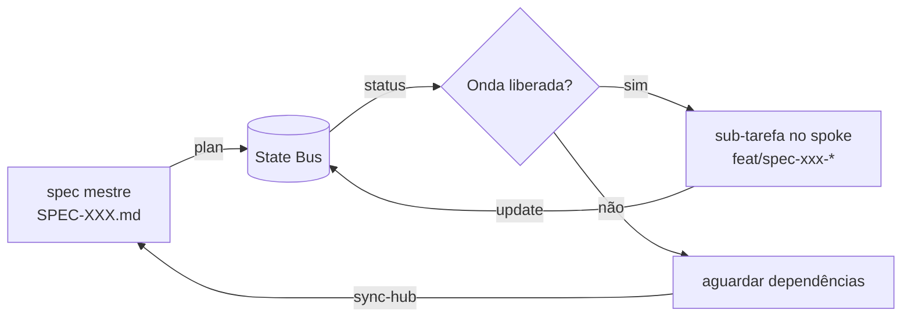

# Fluxo de State Tracking (sem especificação de servidores)

Este documento descreve o fluxo de trabalho do `harness-state` de forma
**anônima**: nenhuma infraestrutura específica é assumida além de um
barramento compatível com Redis, configurável por variáveis de ambiente.

## O que é

O `harness-state` é o cliente e CLI oficial de State Tracking da esteira
SDD federada. Ele gerencia o ciclo de vida de especificações (`SpecRun`),
suas sub-tarefas distribuídas em múltiplos repositórios (`SubTask`) e os
estados de execução (`TaskState`) em um barramento de estado central.

## Pré-requisitos

Somente um serviço compatível com Redis, acessível via rede ou túnel:

| Variável | Função | Padrão |
|---|---|---|
| `HARNESS_REDIS_HOST` | Host do barramento | `127.0.0.1` |
| `HARNESS_REDIS_PORT` | Porta | `6379` |
| `HARNESS_REDIS_DB` | Índice de banco | `0` |
| `HARNESS_REDIS_PASSWORD` | Autenticação (opcional) | — |

Se o barramento estiver atrás de uma rede privada, qualquer túnel SSH
padrão atende — o Makefile do projeto traz um exemplo genérico de `tunnel`
com parâmetros opcionais (`local.mk`).

## Ciclo de trabalho

1. **`plan`** — parseia a spec mestre (`specs/SPEC-XXX.md`) e o
   `manifest.yaml` do ecossistema, extrai as checklistas como sub-tarefas,
   calcula as ondas topológicas (`depends_on`) e grava o plano no
   barramento de estado.
2. **`status`** — consolida o estado corrente de todas as sub-tarefas
   (PENDING → IN_PROGRESS → READY → APPROVED):
   quem está bloqueado, em qual branch, qual o PR aberto.
3. **`update`** — registra transições de estado feitas por qualquer
   executor (humano ou agente) durante a execução de uma onda.
4. **`resume`** — retoma o trabalho no ambiente local *a partir do estado
   do barramento*: faz checkout da branch da sub-tarefa pendente seguinte.

## Integração com a esteira federada

Nesta arquitetura, cada spoke usua este cliente para consultar e registrar
progresso, enquanto o orquestrador central (flywheel) lê o mesmo barramento
para disparar ondas seguintes e executar gates de qualidade. Nada aqui é
específico de nenhum provedor: qualquer deployment que exponha Redis +
SSH basta.
